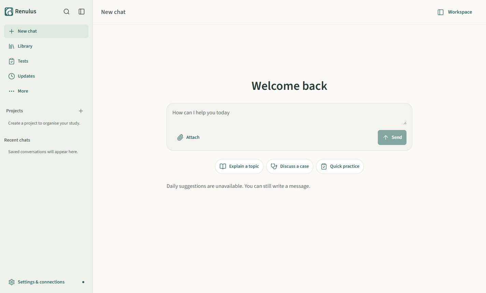
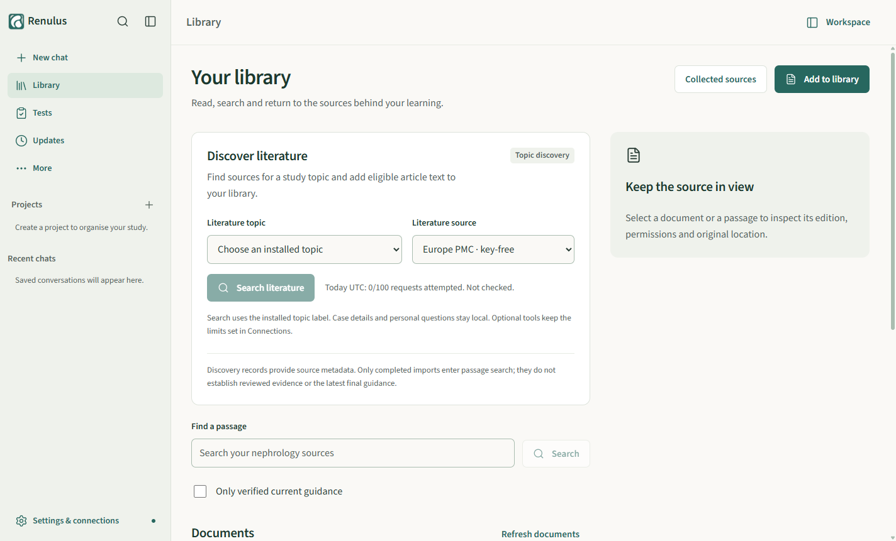
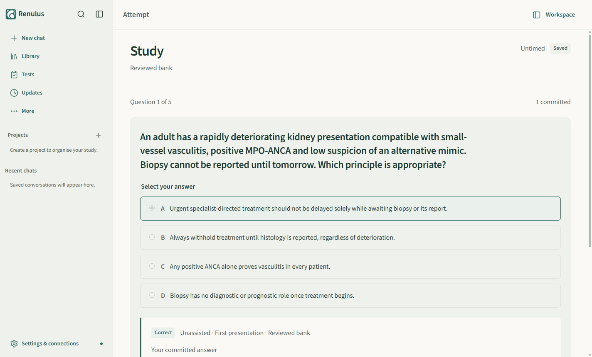
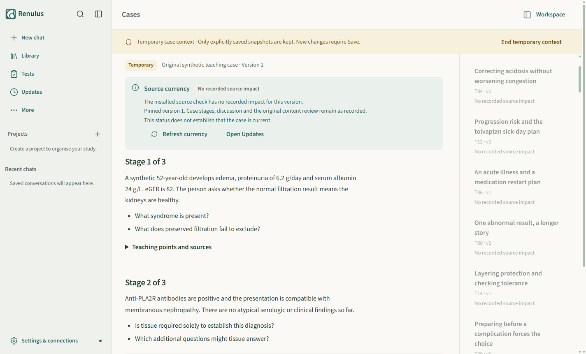
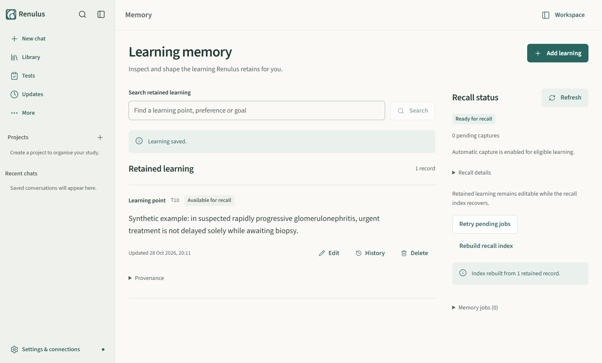
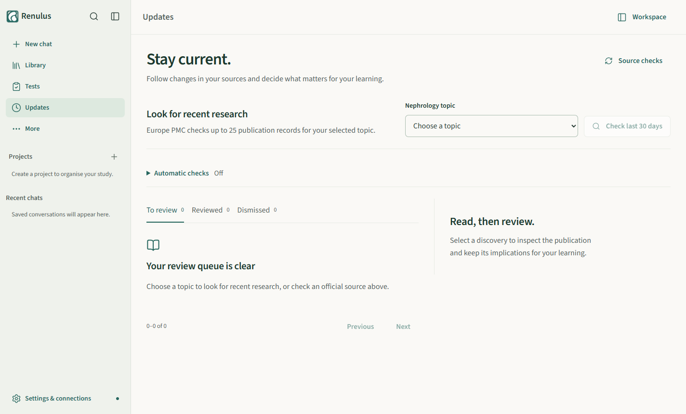
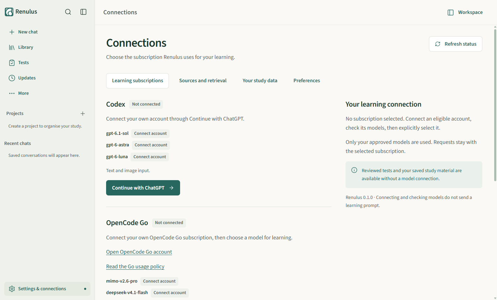

# Renulus

Renulus is an independent, open-source, English-first learning harness for nephrologists practising in the EU, for Windows PCs. It supports specialisation, active study and staying current: explain a topic, discuss a case, practise with reviewed questions, keep and cite your own sources, and follow new guidelines and research. It runs existing models through your own Codex and/or OpenCode Go subscription. The project hosts no service and no model inference, has no paid-API fallback, and needs no GPU, Docker or local model server; small CPU helpers for embeddings and OCR are bundled and managed by the app. Code is MIT, original teaching content is CC BY 4.0. Educational use only: no claim of clinical accuracy or educational efficacy is made.

## What it looks like

Screenshots are from the real Design C app on a synthetic profile, with no account connected.

|  |  |
|---|---|
| **New chat.** Greeting, composer, Explain a topic / Discuss a case / Quick practice. | **Library.** Your sources, passage search and literature discovery. |

|  |  |
|---|---|
| **Tests.** Reviewed question bank, committed answers, then feedback. | **Cases.** Original synthetic teaching cases, revealed stage by stage. |

|  |  |
|---|---|
| **Memory.** Retained learning you can inspect, edit and delete. | **Updates.** Dated source checks and recent research for review. |

|  | |
|---|---|
| **Connections.** Codex and OpenCode Go with their approved models. | |

## For doctors

Renulus is pre-release: there is no signed public installer yet. The Design C app currently runs from source on the owner's PC, and the earlier unsigned packaged build was accepted only there ([status](docs/implementation/RUNNING.md)). Full guide: [Using Renulus](docs/implementation/USING_RENULUS.md).

1. Start Renulus from its shortcut or `Start-Renulus.cmd`, and wait for the managed runtime to become ready.
2. Open **Settings & connections > Learning subscriptions**. For Codex choose **Continue with ChatGPT**; for OpenCode Go save your subscription key.
3. Choose **Check models**, then **Use Codex** or **Use OpenCode Go**, and confirm the **Selected** badge. A connected account alone selects nothing.
4. Approved models: Codex `gpt-6.1-sol`, `gpt-6-astra`, `gpt-6-luna`; OpenCode Go `mimo-v2.6-pro`, `deepseek-v4.1-flash`. There is no silent switch of subscription.
5. Reviewed Tests, teaching Cases, saved Library material and Memory editing work without any connection. Back up under Settings > Your study data; backups never contain credentials.

## For contributors

Prerequisites: Windows; Git; Node 22.22+ or 24.11+ for `apps/desktop` (checked on 24.15; its UI tests fail on Node 26); exactly Node 26.4.0 for `packages/backend` and `packages/harness`; Python 3.12 to 3.14 with `uv`.

```powershell
uv sync --extra test                         # Python environment (uv.lock)
cd apps/desktop; npm ci                      # desktop dependencies
npm run build                                # typecheck, renderer and Electron entry
npm run dev:electron                         # isolated dev profile; set an absolute RENULUS_PROFILE to keep one
npm test                                     # vitest, synthetic data only (set RENULUS_TEST_PYTHON to the Python above)
python scripts/check_workspace.py            # layout and link checks (from the repo root)
```

Backend packages (Node 26.4.0 on `PATH`): `npm run typecheck`, `npm run build` (backend only; `dist/` is git-ignored and required by the facade tests) and `npm test` in `packages/backend` and `packages/harness`; Python: `python -m pytest tests/workers tests/runtime/test_domain_process.py tests/backup/test_restore_frontier.py`. The full backend suite takes about 25 minutes and needs offline helpers, fresh scratch roots and a drive with more than 12 GiB free; use the exact environment under "Final verification" in [the backend finalisation record](docs/implementation/BACKEND_FINALISATION_20261027.md).

| Path | Contents |
|---|---|
| `apps/desktop` | Design C React renderer, Electron main process, packaging scripts |
| `packages/backend`, `packages/harness`, `packages/contracts` | TypeScript/Effect backend target, managed OpenCode v2 harness, shared contracts |
| `runtime/renulus` | Python backend: canonical SQLite services and engine adapters (Mem0, Docling, FastEmbed, LanceDB) |
| `content` | Versioned original teaching packs (pack 1.4.2: 27 topics, 251 questions, 59 cases) |
| `upstream` | Pinned Hermes and OpenCode sources with patch provenance |
| `packaging`, `scripts`, `tests` | Backend bundling, launchers and checks, test suites |
| `tools/renulus-control` | Hidden, app-scoped Playwright controller for UI checks ([how](docs/implementation/APP_CONTROL.md)) |
| `docs`, `assets`, `references` | Decisions, specs, evidence, brand, dated references |

UI checks: `npm ci --ignore-scripts --prefix tools/renulus-control`, build the renderer, then drive the controller with `node tools/renulus-control/client.mjs` using the fixed options in [APP_CONTROL](docs/implementation/APP_CONTROL.md). It uses its own synthetic profile and hidden windows.

## For coding agents

- Read [AGENTS.md](AGENTS.md) first, then this README, [PROJECT_BRIEF](docs/PROJECT_BRIEF.md) and [WORKSPACE](docs/WORKSPACE.md). Keep edits to the request; research does not authorise implementation.
- Confirmed choices and open work live in [DECISIONS](docs/DECISIONS.md) and [user answers](docs/planning/2026-10-04-user-answers.md); do not turn proposals into decisions. Sources: [SOURCES](docs/SOURCES.md).
- Use synthetic data only. Never read, copy, commit or transport secrets, patient records, the owner's learning profile or accounts.
- Do not add conversational models, paid-provider fallbacks or user-managed local runtimes; do not train, deploy or call paid providers incidentally.
- Work on `codex/` branches from the shared committed baseline; follow [ARCHITECTURE](docs/planning/ARCHITECTURE.md) and [PARALLEL_WORK](docs/planning/PARALLEL_WORK.md); check branch and tree before handoff.
- Check the UI only through the [app-control tool](docs/implementation/APP_CONTROL.md): no Computer Use, OS input, `focus()` or `bringToFront()`.
- Specs: [Backend finalisation](docs/planning/BACKEND_FINALISATION_SPEC.md), [Design C](docs/planning/DESIGN_C_IMPLEMENTATION_SPEC.md), [OpenCode v2 plan](docs/planning/OPENCODE_V2_INTEGRATION_PLAN.md).

## Current status

- **Delivered locally (MVP, October 20):** Design C source app on the owner's PC; saved learning chat on OpenCode v2; one live Codex GPT 6.1 Sol text answer through the production backend. Not shown: live OpenCode Go, images, packaged acceptance ([record](docs/implementation/MVP_20261019.md)).
- **Backend finalisation BF00 to BF08** (branch `codex/backend-finalisation`): TypeScript/Effect backend, native OpenCode plugins, and the profile-wide Python → TypeScript handoff with rollback, selector-routed Electron launch and a closed, verified backend bundle. All proven on isolated synthetic profiles only; this is implementation evidence, not acceptance ([record](docs/implementation/BACKEND_FINALISATION_20261027.md)).
- **Not switched:** the owner's profile still runs on the Python writer. Cutover waits for live account qualification, because the new backend refuses model calls without installed route evidence.
- **Open:** live account qualification, packaged installer and physical Windows acceptance, schema-1 migration proof, storage reclamation, OAuth for MCP.

## Licences and notices

Code: MIT ([LICENSE](LICENSE)). Teaching content: CC BY 4.0 ([content/LICENSE](content/LICENSE)). Third-party and user-owned material keep their own terms ([notices](THIRD_PARTY_NOTICES.md)); the foundation reuses [Hermes](upstream/hermes/README.md) and [OpenCode](upstream/opencode/PATCHES.md) with attribution. Brand: [C, Renal flow](assets/brand/README.md).
