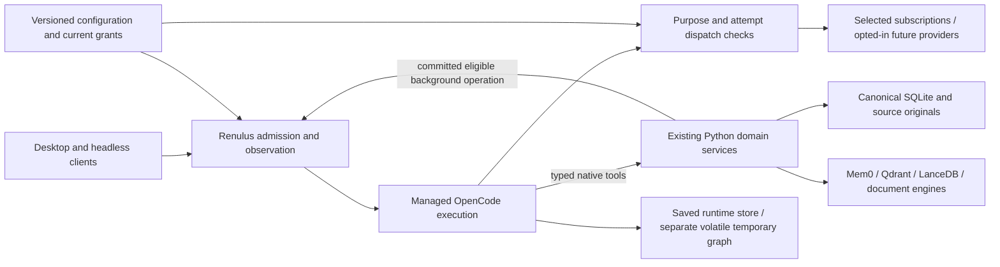

# OpenCode v2 integration plan

**October 26 finalisation target:** the owner's later TypeScript/Effect + Python,
full-tool and plugin-lifecycle instruction is consolidated in the
[single backend finalisation spec](BACKEND_FINALISATION_SPEC.md). It governs the
new target and migration wave order. Retain the H criteria, confirmed product
rules and dated evidence below; their older status headers do not override the
later MVP or current acceptance maps. The new spec is a planning deliverable,
not evidence of implementation or release.

**Canonical handoff amendment:** the exact older working draft is preserved in
`75b4b503` and its [snapshot manifest](../implementation/opencode-plan-snapshot/manifest.json).
The bounded Design C closeout repairs H00 in `fa3b590c`; H12 consumes that
prerequisite. Read the [final integration handoff](../implementation/DESIGN_C_OPENCODE_HANDOFF.md)
before starting any H slice. H01/H24 now have local foundation acceptance from
`c2bd896420fb88f76d63ca576414dbbba182f4c2`; consume the
[foundation implementation handoff](../implementation/OPENCODE_FOUNDATIONS_HANDOFF.md).
H02 is planned next. Other
uncompleted tickets remain planned. DC21 default release remains deferred to
combined H20, not passed by the current UI review.

2026-10-10. **Reviewed planning baseline: six adaptive waves, 25 subagents and 25 tracked slices.** H00 is consumed; H01/H24 have local foundation acceptance and 22 slices remain planned. The owner's OpenCode selection supersedes the earlier Pi proposal. This plan coordinates with Design C; it does not replace its layout, readers, assessment or retention requirements. The [three specs and ticket breakdown](opencode-v2/README.md) retain their acceptance gates.

**Implementation authority and seams:** the owner's [later instruction](2026-10-04-user-answers.md#october-10-first-opencode-foundation-implementation-authorisation) authorised the first foundation tickets; the integration task selected H01/H24 using the existing public domain/conversation plus Harness seams. Implementation used behavioural failing tests followed by minimal repairs. Tracker publication is not required. The separate implementation handoff records host/worker acceptance; H02 and the later migration/account/release gates remain open.

The later [H00 reconciliation](../research/2026-10-10-opencode-integration/h00-handoff-reconciliation.md) preserves the independent preliminary source/receipt inspection. Its appended final-closeout note points to the subsequent passing App evidence; the original 99-file snapshot remains unchanged.

**Historical baseline correction during wave 3:** this research checkout remains at
`528025ff`; the active Design C integration branch is substantially newer at
`76cfdff23e259700bec820e174c200540c7c1e1b`. Source checks and tests in waves 1–2
describe the older snapshot. Current-work integration was re-audited and focused
tests were run against the newer committed source; those checks supersede any claim that existing
Design C producers still need to be created. No other worktree is being edited.

## Decision and evidence baseline

Adopt OpenCode v2 by embedding its connected runtime, with Renulus plugins and a small host integration. Preserve the existing Python domain modules and approved data engines. Use one execution owner, one authoritative transcript per conversation, one configuration authority and one final dispatch policy. Avoid extracting a runner, duplicating child coordination or introducing another general workflow engine. This follows the [side-chat analysis](../research/2026-10-10-pi-opencode-v2-side-chat-findings.md) and the [current implementation inventory](../research/2026-10-10-opencode-integration/w1-01-current-integration.md).

The first proof uses source **4b6fea2875e4f2e3e8a8fee181803e54f7056845**, built with its coherent dependency cohort and lock. Source declares Effect 4.0.1; the published SDK 2.0.26 uses rc.112 and starts recovery before supplied-plugin registration. Do not mix these artifacts. The executed H01 foundation uses managed **Node 26.4.0 x64**, because the inspected runtime closure requires that version; it supersedes the research proposal of Node 24.21.0. Bun 1.4.2 remains the build tool. The real SDK loop, native SQLite, gated activation/recovery and counting synthetic inference now have direct local evidence. Production account integration, fresh-checkout build automation and packaged acceptance remain separate work. [Dated artifact research](../research/2026-10-10-opencode-integration/w1-03-artifact-host.md), [executed cohort provenance](../../upstream/opencode/UPSTREAM.md), [H01 evidence](../implementation/opencode-foundations-h01.md).

## Main integration pieces

| Piece | Keep/reuse | Add or change | Completion evidence |
| --- | --- | --- | --- |
| Execution and host | OpenCode loop, sessions, tools, children, events and recovery; existing owned Windows-child lifecycle patterns | Headless harness interface, persistent profile-owned runtime store, readiness/dispatch gates, bounded shutdown and one owner | Same cited learning operation through headless and desktop clients; stop, disconnect, owner death and reopen |
| Configuration and providers | OpenCode registration/resolution; Renulus selected subscriptions, credential protection and settings | Versioned effective configuration, purpose routes, final endpoint/model/attempt enforcement, controlled activation and revocation | Denial causes zero dispatch on every primary/auxiliary/child/recovery path; last-known-good adjustment and visible failures |
| Tools and extensions | Native tool registration; OpenCode skills/MCP machinery; existing domain methods | Reviewed capability set, scoped executor envelopes, explicit instruction/skill/plugin/MCP manifests | Retrieval and deliberate mutation respect current rights, pending revocation and child grants |
| Data, memory and context | SQLite canonical records; Mem0/local Qdrant; Docling/HybridChunker; FastEmbed; LanceDB | Completed-answer references and dependency lineage, context manifests, route-aware budgets, educational compaction and navigable historical detail | Corrections/deletions survive capture, compaction, children, restart and restore; evidence can be reopened exactly |
| Learning workflows | Landed saved-generation checkpoints/publication, Home/nightly, conversation receipts, deterministic attempts and source checks | Bind existing jobs to OpenCode execution/attempt identities; adapt their submission boundary; add purpose-specific explanations | The existing 5/10/20-question producer preserves validated batches, reconciles lost acknowledgements, and never duplicates publication |
| Migration and clients | Design C contracts, content/originals/history and existing renderer | Explicit conversation import/read compatibility, consistent backup bundle and rollback rules, progressive client adoption | Populated synthetic migration, old exports, temporary exclusion and packaged Windows acceptance |

## Ownership and small interfaces

**OpenCode owns operational execution:** the live transcript, inbox/claims, tool lifecycle, child coordination and context lifecycle. **Renulus owns canonical domain records:** conversation/project metadata, Library rights/revisions/originals, learner facts and observations, assessment attempts/test versions, operation receipts, configuration and deletion tombstones. Summary trees, indexes and UI event projections are derived. A mapping is not a second writable transcript.

The public harness interface admits a typed operation with an idempotency key, explicit scope and configuration reference; returns an execution identity; exposes current state plus ordered observable events; accepts permission/resume decisions; and cancels with a separately observable settlement outcome. Ordinary domain operations (Library listing/import, reviewed scoring, memory editing, source review) remain callable directly without an agent turn. Existing authenticated local transport conventions can carry this interface; the renderer does not reconstruct a scheduler. [Current contracts and ownership](ARCHITECTURE.md), [actual integration inventory](../research/2026-10-10-opencode-integration/w1-01-current-integration.md)

Keep one profile-owned Python domain process with its current engines and one managed OpenCode host. Reuse the existing desktop supervisor pattern, adding a headless entry point and explicit ownership/readiness handshake. Define whether a client disconnect merely stops observation, whether an explicit Stop cancels a run, and whether host shutdown leaves work resumable. Do not tie domain work to component mounting. Runtime packaging remains the first implementation gate.

One managed process may contain two isolated runtime graphs: a persistent saved-conversation host and a separate in-memory temporary host. Selected OpenCode instances share a database; a temporary flag or instance name is insufficient. Temporary tool-output spills, attachments, descendants and logging also need volatile/redacted implementations. Disable retained event payloads initially and serve reconnection from canonical current state/receipts. Explicitly audit any later event retention for erasure. [Host/retention adversarial review](../research/2026-10-10-opencode-integration/w3-04-host-proof-adversary.md)

Use native tools for internal retrieval, passage reads, learning progress and validated domain commands. Use MCP for external integrations that benefit from that protocol. A tool envelope binds the authenticated profile, conversation/project, operation, parent, retention, grant/configuration revisions, expected domain revisions and cancellation epoch. Model-supplied arguments cannot widen these values. Executors check them again at the effect/commit seam.

The IPC boundary is versioned and authenticated to owned processes, multiplexed and cancellation-aware. Python keeps canonical transactions short and performs no model request while holding a write transaction. Memory extraction starts from a committed eligible-answer receipt as a separately admitted purpose operation; it must not synchronously call back into a host that is waiting on the same tool. Bound queues/backpressure and test host/domain death in each direction. Persist only references and outcome identities in operational envelopes; redact payloads from diagnostic logs. The adapter, rather than renderer mounting or a second generic scheduler, handles these lifetimes.

Bind IPC frames to protocol/profile/store, process-start generation, logical operation/attempt and unique request ID. Reject stale-generation replies. Negotiate frame/in-flight bounds, reject overload before admission and reserve control capacity for cancel/revoke/settlement. Observation timeout is not permission to resend. Keep the receive loop available while handlers await replies. Rebind the current assessment/Study publication guard on every callback; its existing ContextVar cannot cross IPC.

IPC outcomes distinguish rejected-before-admission, accepted/pending, committed-reference, cancelled/settled and uncertain-after-disconnect. Command replies cannot use an observation queue's drop-oldest policy. No cross-process wait of any kind is allowed inside canonical transactions or conversation/case/recovery physical locks; publication callbacks perform local-only validation. For recovery, close admission with a logical lease, drain remote work before taking engine guards, then snapshot/commit locally. Bound the shutdown drain attempt; successful ownership release requires actual settlement, otherwise retain a blocked/uncertain handoff state.

Current memory answer resolution runs inside some SQLite write transactions. Resolve immutable digest-bound answer content outside transactions and physical thread locks; commit checks only local receipts, dependencies and current epochs. Keep the event loop/IPC pump available while the existing extraction worker waits for model output. A controlled shutdown probe also found `MemoryService.close()` can return while its extraction thread still runs; no late facts were produced in that probe. H24 adds a real worker lease and settlement proof before store/engine handoff. Close admission, cancel, keep replies available through bounded drain, and release stores only after actual worker/finalizer settlement. Timeout leaves handoff blocked/uncertain. [IPC and worker-lifetime review](../research/2026-10-10-opencode-integration/w5-02-ipc-lifetimes.md)

## One configuration authority

Stage a complete configuration revision; validate schemas, package/content identities, route requirements and resource references; instantiate and health-check a candidate; activate by an atomic canonical pointer change. Record the effective version and failure reason. A failed change retains the old healthy configuration or leaves the requested capability unavailable. Upstream reload is not itself this transaction. [Extension/reload evidence](../research/2026-10-10-opencode-integration/w1-04-extensions.md)

Construct candidates with recovery, generation, package acquisition and external MCP startup closed. Verify the effective registry after every upstream transform, not only successful plugin setup. Candidate instances must not become another writer/recovery owner of the live store. Reconcile crashes between readiness, pointer activation and opening admission. A restored older plugin generation is a failed candidate, even if it is healthy. [Activation analysis](../research/2026-10-10-opencode-integration/w2-05-configuration-revocation.md)

Version roles, prompts, instruction/skill contents, plugin identities/hashes, MCP endpoint/tool identities, purpose routes, context profiles and retry budgets. Store credential references, never secrets in session metadata. Sessions bind an immutable version; an explicit migration changes it. Current revocations immediately narrow existing sessions, queued operations, approvals and children. Effective authority is the intersection of the pinned version, current grants and operation scope. Rollback may restore behavior, never revoked permission.

Start with validated restart-based activation under an admission/quiescence barrier; simultaneous hot replacement is not required. Settings expose requested, effective and failed revisions. An active run retains its version unless explicitly cancelled/migrated; a change cannot silently move it to another model. Preserve the existing ProviderManager connection/catalog authority and bind its protected references into the runtime. Do not maintain two independent model selectors. [Current-work review](../research/2026-10-10-opencode-integration/w3-03-minimality-design-c.md)

Keep managed locations and configuration roots separate from personal OpenCode state. Disable ambient configuration/credential/plugin discovery through proven host replacements. Remove irrelevant coding tools, agents and skills from the exposed capability set; do not claim that this prunes their dependency graph. Executable plugins are trusted application code, not sandboxed by their manifest. User-supplied instructions and retrieved text remain data and cannot install them. Package acquisition and activation are explicit configuration operations.

MCP enable/disable, endpoint changes and credential removal have distinct behavior. Bind grants to server and tool identities/schema versions, recheck at execution, and treat ambiguous remote side effects as uncertain. Initially omit Code Mode and generic shell/file tools unless an adopted use case needs and validates them. Skills provide task guidance; loading one never grants new tools.

Instruction precedence is explicit: mandatory product policy and typed operation constraints, then the explicit user request, then optional role/skill guidance; retrieved passages/history are delimited evidence. An optional skill cannot override an explicit user preference, and neither can widen executable authority. Enforcement comes from domain/dispatch policy, not prompt wording. On compaction/reopen, re-inject the run's pinned instruction version plus current mandatory scope/revocation constraints; do not silently replace it with a newly edited global skill or revive serialized old instructions. An explicit configuration migration changes the pinned version.

Disable the generic execute capability as well as MCP Code Mode. Hidden definitions alone do not remove nested capabilities; internal MCP reconnect can repeat a call below an outer guard. Check every actual connection dispatch and any adopted direct call path. Revocation wins before serialized effect admission; after admission, an external effect may already have occurred. Receipts do not make a remote server transactional.

## Models, purposes and fallbacks

Keep the exact selected initial models: Codex `gpt-6.1-sol`, `gpt-6-astra`, `gpt-6-luna`; OpenCode Go `mimo-v2.6-pro`, `deepseek-v4.1-flash`. Preserve the chosen connection/default. The evidence does not establish a best model per task or verified 128K–256K capacity for these account routes. Start role assignments by inheriting the user's selected model; promote a specialized assignment only with a recorded quality/capability evaluation. [Routing/source audit](../research/2026-10-10-opencode-integration/w1-05-model-routing.md)

| Purpose | Required behavior | Initial assignment/control |
| --- | --- | --- |
| Explain and case discussion | Cited text, streaming and tools when exposed | Selected connection/model; evidence retrieval enforced independently |
| Image understanding | Actual image modality for required input; retain MIME and image provenance | Selected model only when supported; no silent OCR-only substitution |
| Evidence/review child | Narrow task, current source scope, constrained tools and structured report | Inherit parent connection/allowed set; explicit role override within it |
| Generated practice/questions | Bounded structured candidates, source locators and independent validators | Selected model; validated batches; no automatic scored-bank promotion |
| Test-result explanation | Explain deterministic results without changing marks or mastery evidence | Separate configurable role; numerical results available without inference |
| Memory extraction | General eligible learning, structured output, provenance | Selected model via one dispatch interface; no independent Mem0 key |
| Educational compaction/tree summaries | Preserve exact decisions, values, corrections and source references | Explicit summary role/budget; no tools; failure preserves originals |
| Daily suggestions/Updates digest | Eligible learning/source inputs, dates and bounded outputs | Configurable background role; scheduling/checks remain deterministic |
| Titles | Short label | Deterministic first; optional explicitly routed generation |
| OCR, embeddings, ranking | Existing managed CPU processing | Retain current engines; no generative dispatch for routine deterministic work |

Route precedence is authorised operation override → role override → parent → selected root; a disabled role cannot be revived by an operation override. Invalid overrides fail visibly. Automatic follows the existing allowlist order filtered by catalogue membership, then falls back to the first allowed ID; catalogue membership is a set, not a provider-returned ranking. Keep existing producer purposes, including `fictional-test`, `test-import` and `daily_suggestions`. The 401 regression requires access to become unknown/reconnect-required even when a protected credential still exists; reconnection starts a new observation epoch. [Capability and evaluation contract](../research/2026-10-10-opencode-integration/w3-02-capabilities-evaluation.md)

Proposed initial configurable bounds: a foreground explanation/case or multi-stage generation/import/fictionalisation operation has at most 12 actual inference dispatches shared across its root, children and auxiliary compaction; the existing saved-generation twelve-batch counter remains an additional ceiling. Each model step is sent once, with zero automatic retries or substitutions; a tool continuation is a new step and consumes another permit. Standalone memory extraction, summary, result narrative, daily bundle and digest operations have one dispatch; deterministic titles have zero. Start child depth at one and child concurrency at two, and retain the existing three-active-generation-job bound. Use a default 4,096-token output allowance, narrowed to proven route caps and adjustable by purpose. These are proposed bounded defaults, not measured optimal values; the consuming owner must validate them with task fixtures before promotion. Explicit retry preserves spent operation permits.

Every dispatch, including auxiliary generate/title/summary paths, needs an enforced effective output cap and a final assembled input/output/window check after hooks. Raising the context profile never bypasses these per-request limits. F0 and the consuming domain owner own role evaluations: compare inheritance with a proposed specialization on synthetic varied-domain fixtures, repeat trials, require all critical invariants and record a measurable benefit. The earlier 22/24 rubric suggestion is provisional, not a clinical efficacy threshold or a confirmed decision.

A standalone one-permit operation must fit before dispatch or fail visibly; implicit pre-compaction cannot receive a free second call. Preserve useful checkpoints on permit exhaustion. A lower route/output limit narrows the proposed allowance rather than silently substituting another model.

The route record binds purpose, connection and credential revision, catalog and wire model identities, protocol, endpoint, capability evidence, allowed attempts, budget and operation/parent identities. Gate all stream/generate/compact paths, children, title retry, compaction repair/overflow handling and recovered work. Check final dispatch after request hooks; neither a filtered model list nor a throwing customization hook is sufficient.

This is one policy enforced at several actual dispatch points, not one HTTP wrapper. Include stateless plugin generation, native and managed AI-SDK transports, WebSocket handshake/reused-channel sends, and HTTP fallback. The source supports dependency-preserving host decorators, but their exact compiled composition and typed error mapping remain first-slice proof. Default-deny unadmitted stateless calls and unverified custom adapter/fetch paths. [Concrete composition analysis](../research/2026-10-10-opencode-integration/w2-02-dispatch-recovery.md)

Separate initial selection, deterministic degradation, same-route retry and model/provider substitution. Starting defaults preserve visible authentication/quota/model/image rejection, no automatic subscription switch and no automatic resend of uncertain generation after a crash. Bounded retry/repair and alternative models can be configured explicitly with error classes and attempt receipts; they must not create hidden request multiplication. A network timeout after dispatch is not proof that generation never occurred.

Optional future vLLM/Ollama/new providers use the same connection descriptor and capability contract. Adding a compatible URL does not establish tools, images, structured output, context size, stateful Responses or native compaction. Test model/deployment/chat-template combinations. Optional connections remain disabled until deliberately enabled; ordinary doctors still need no local inference installation.

## Memory, retrieval and 128K–256K context

Retain the approved memory/document engines. Before new automatic capture, persist exact dependencies on the memory/source revisions used by completed answers. All four queued/follow-up recapture cases remain reproduced at current `76cfdff`: a new answer can recreate corrected/deleted text under a new fact ID. Existing restore and same-source suppression tests pass but do not cover this missing dependency. Add a versioned completed-answer resolver over OpenCode message IDs and content hashes; commit dependency references, not a second authoritative answer log. [Current reproduction and regression checks](../research/2026-10-10-opencode-integration/w4-01-current-memory.md)

Independent reproduction also found stale text re-entering through a follow-up after the first capture had completed and been suppressed. Dependencies therefore cover historical messages, tool results and summary nodes as well as the current memory retrieval. Bind receipts to store/profile/message/range identities, canonical text serialization, completion, accepted finish and final domain publication. Unknown legacy lineage is ineligible for automatic recapture. [Four-case reproduction and contract](../research/2026-10-10-opencode-integration/w2-01-memory-dependencies.md)

Preserve current temporary/saved-case eligibility: temporary ordinary conversations skip Study recall/capture; saving a case does not make its raw contents eligible. Existing learner memory is profile-global. For migration, label those facts global and preserve their scope; explicitly project-owned new memory requires scoped identity/deduplication and admission. Moving a chat never relabels a global fact or historical receipt. A context-epoch increment alone is not a fix: existing scans can requeue boundary-cancelled work, so revoked dependency lineage must remain terminal.

Distinguish learner observations, user preferences, generated teaching points, conversation summaries and Library scientific evidence. Generated explanations cannot establish mastery or become reviewed sources. Define profile-global versus project memory explicitly; current profile-local Qdrant identity is not project isolation. Automatic capture follows eligible domain publication; arbitrary tool/child/summary messages do not become memory producers.

Reuse the current typed relations and restore barriers: current-code helper checks fixed the old generic deletion cascades. Separate truth support from storage ownership. Inputs inside one support group are jointly required; independently rooted groups can support a fact separately. Echoes inherit their roots and cannot manufacture independence; direct deletion overrides all support. Ordinary chat deletion preserves separately retained eligible learning under Design C's disclosed rule, while the explicit delete-related-learning choice revokes its dependent support. This is distinct from correcting/deleting the fact itself. [Current migration/retention audit](../research/2026-10-10-opencode-integration/w3-01-migration-retention.md)

For each model dispatch, produce a context manifest identifying instruction/configuration version, scope, exact user task, recent complete exchanges, pending tool results, selected learner records/revisions, eligible source passages/revisions and any historical summary ranges. Validate current scope/revocation before dispatch and publication. Expired source eligibility, corrections and tombstones invalidate derived summaries and descendant contexts as well as vector hits.

128K and 256K are requested **token ceilings**. Effective input is bounded by the smallest proven model/deployment/account limit and configured ceiling, after output, tool-result and estimation reserves. Treat unknown limits as unknown; show an unavailable/lower profile rather than pretending a requested ceiling is active. Calibrate token estimates and count tool schemas and images. Do not enlarge the current constant and call this accepted support.

The [article investigation](../research/2026-10-10-opencode-integration/parent-context.md) supports evaluating a persisted summary tree with exact-history zoom and batched view updates. It describes byte budgets, not 128K-token capacity. Use the OpenCode transcript as the source; preserve current instructions and recent complete exchanges. Start with educational compaction plus exact history retrieval, then enable tree-assisted context after correction, deletion, recall and cost tests. Permit reference/lexical search as a second way to find omitted details. Do not adopt eternal retention, summaries-as-truth or provider-specific cache claims.

H10 must deliver exact older-range lookup and eligibility failure as part of compact/continue behavior. H11 is the later evaluated tree strategy; it does not block the baseline harness cutover. Tree activation requires its own recall, deletion and paired-store restore matrix. Optional providers may use a lower verified context window; H19 depends on the accounting contract, not proof that every provider has 256K capacity.

Only one conversation-context owner runs. Replace the Hermes compressor for migrated conversations. Prefer the OpenCode compaction-result/context interfaces; validate required educational summary readiness and prohibit fallback to the stock coding summarizer. Route-specific native checkpoints cannot cross incompatible model/endpoint changes; reconstruct eligible history instead. Temporary conversation history/tree/attachments remain volatile.

Initial configuration uses summary compaction and disables native opaque checkpoints. The supplied-result seam cannot replace OpenCode's separately selected recent tail; that tail clips tool output and represents attachments as labels. Reconstruct eligible complete recent exchanges from authoritative IDs and replace the serialized tail without duplicating it. Preserve tool call/result ordering and media availability. Check the **final assembled** request independently: hook additions occur after upstream estimates, and same-provider route changes can retain misleading measured usage. Selective erasure of persisted recent text/events is a separate acceptance gate, not solved by prompt filtering. [Context seam and source-formula probes](../research/2026-10-10-opencode-integration/w2-04-context-integration.md)

## Deterministic workflow and recovery contract

Use the existing domain validators and receipts as the authority for results; OpenCode remains the execution owner. A workflow specifies bounded domain stages and child roles, not a second generic agent loop. A generated-test job records requested size, input/source versions, validated batches, pending model attempt identities and a single publication identity. The chat card and Tests collection reference the same saved version. Reviewed scores and attempts retain their existing deterministic path.

At the current baseline these are implemented owners: `SavedGenerationService`, `SavedTestRepository`, `ConversationStreams`, Home and `NightlyService`. Extend their current command keys, checkpoint schemas, policy/context epochs and publication guards. Replace only their execution/provider-task boundary when OpenCode becomes execution owner. The current generation service deliberately marks interrupted jobs without sending another request; preserve that behavior. Current code also includes fictionalisation, imports and active-Test assistance restrictions; all new native tools/children must use the same policy. [Current integration delta](../research/2026-10-10-opencode-integration/w3-03-minimality-design-c.md)

H22 adapts temporary-input fictionalisation/review/publication; H23 adapts imported-test refinement/edit/resolve/publication. Both retain their existing producer/validator, route purpose, explicit retry and canonical version identity. Active-Test admission and publication are initial H02 requirements, then extended by H07 children and H09 MCP; H14 consumes that authority for results rather than owning a late global retrofit.

Current workflow definitions already use batches of up to five for 5/10/20 questions and one fifteen-prompt daily bundle. Preserve the generation job's 12 batch-call counter, three active-job limit, validated checkpoints and explicit retry/shorter-set rules. Twelve batches are not a total inference-call ceiling: auxiliary compaction needs its own shared attempt accounting. Optional result explanations consume key-free deterministic aggregates; Updates digests cannot mark editions reviewed. [Current workflow audit](../research/2026-10-10-opencode-integration/w4-02-current-workflows.md)

Consumed prerequisite H00: the `76cfdff` research baseline reproduced a missing retrieval-guard interface before dispatch (8 passed / 16 failed in the selected workflow tests). Canonical repair `fa3b590cd40de145c198a64168aa46b82384e2bc` now requires an explicit callable guard, re-resolves the saved job's existing authority around retrieval I/O including failure, and preserves the legacy caller's real guard. Inspected receipts show 13 focused passes and 161 unique affected cases with passing evidence across a 160-pass run plus one corrected-fixture rerun; this is not one fully green affected-suite run. H12 consumes and revalidates that guard while changing execution ownership. The later final Design C handoff records the subsequent 2/2 full App producer rerun with clean shutdown in `connected-ui03.xml`; retain that final evidence alongside the preliminary inspection. Preserve the historical failed probes and the existing publication fence. [H00 reconciliation](../research/2026-10-10-opencode-integration/h00-handoff-reconciliation.md)

A canonical operation key includes a payload digest. Reusing an ID with a different payload is a conflict. Before a tool effect, check revision/scope/cancellation; after commit, return the canonical receipt. If the runtime dies between commit and acknowledgement, replay reads that receipt. If a model request may have been sent but no terminal response is known, record uncertainty and await the permitted recovery decision. Do not pretend two SQLite databases share a transaction.

Persist stable engine session/input IDs before delivery and distinguish admission replay from permission to wake execution. OpenCode's inbox identity checks are not a payload-digest guarantee. Reserve a durable purpose/attempt permit before actual outbound generation; auxiliary retries consume separate permits. Lost acknowledgements reconcile inbox/history/receipts rather than granting another attempt. Current saved generation already rechecks sources, policy, execution, settings and context inside its canonical publication transaction. Preserve this fence and explicitly bind its authority across IPC; process-local context variables do not cross the process boundary.

Cancellation has a durable epoch. If commit wins, return the committed result; if cancellation wins, prohibit late publication. Parent cancellation propagates to owned children and domain workers, with settlement separately visible. Child permissions only narrow the parent grant; source inspection does not prove OpenCode's default merge enforces this invariant. Bounded depth/concurrency/tool/output/attempt budgets are configuration, not prompt suggestions.

Application-running nightly work reuses the approved bounded scheduling semantics and one catch-up. It submits ordinary typed operations through the same harness/dispatch interface. Source-change detection, ingestion and index rebuild can be deterministic workers; they do not need conversational turns.

Reuse the existing local-date occurrence/frontier and eligibility token. Preserve the distinction between one latest-due catch-up after sleep while the process is running and a cold restart that arms a future night. Do not add cold-start catch-up silently. Bridge the current claim-before-job-create gap with deterministic delivery reconciliation: an unsubmitted claim can create its existing keyed job once; a possibly dispatched model attempt stays uncertain. Test DST, timezone changes and clock rollback. Disabling scheduling revokes pending dispatch and publication. Home inputs are currently global; project-specific suggestions are a separate configured extension, not established behavior.

## Current work, migration and patch budget

Design C was recorded as not started at the older research snapshot; the active integration branch now contains conversations, projects, readers, saved tests, 5/10/20 generation, whole attempts, Home and nightly modules. Source presence is distinct from working acceptance; wave 4 records passing existing flows and the historical generation defect subsequently repaired by H00. The final Design C handoff governs the later baseline and passing App evidence. Preserve the existing IDs and owners: DC02 owns shared identity/scope/backup contracts; DC04 conversation semantics; DC06 suggestions; DC08 readers/extraction; DC12–DC19 assessment/saved-test behavior; DC20/DC21 integrated and Windows acceptance. Harness tickets replace execution beneath these actual producers instead of recreating them. The [current source map](../research/2026-10-10-opencode-integration/current-source-map.md) and wave-4 findings define the reviewed delta.

Import existing saved history with stable legacy mappings and citation/provenance preservation. Do not import temporary buffers or dispatch a model during migration. Freeze legacy writes when each conversation switches; retain an explicitly read-only old-history adapter. Keep original files, shared Library references and reviewed attempts intact. Backups need one manifest covering runtime and canonical stores, source versions and tombstone frontier; snapshot under a quiescence barrier or another demonstrated consistent protocol. A rollback never opens a newer schema with an older host or dual-writes transcripts.

Extend the current recovery barrier and schema-2 compatibility converter. H01 establishes store/engine identities and the versioned paired-store manifest contract, initially prepared with validation pending. H02 validates the actual stores and activates the initial selection before its first saved mapping; it must also support reopening that validated selection. H06 consumes it for saved-history migration; H18 proves the complete deletion/restore matrix and restored-generation activation. This distinction avoids making the first saved flow depend on the later full restore milestone. One M5/integration owner controls support/lineage schema edits across H05 and H18. Snapshot both stores and originals under bounded writer quiescence, publish the verified manifest last, and select a complete generation atomically. Abort on a writer that cannot settle. After new writes, rollback requires compatible recovery/read-export; never silently discard those writes.

Current synthetic learning and case reproductions confirm deleted draft text and payload hashes remain in command receipts/new exports. Retire payload-bearing receipts with owner deletion, including creation receipts whose target is `new` but whose result identifies the owner. Replay should resolve a live canonical result by reference or return terminal-unavailable using an opaque operation tombstone; deleted payloads/digests must not survive in new exports. Retain deduplication identities while an old backup could replay them. Existing external backups cannot be remotely erased; restore must apply the current frontier before activation, with an untrusted/missing frontier restricted to inspection. [Current conversation tests and residue reproduction](../research/2026-10-10-opencode-integration/w4-03-current-conversations.md)

Preserve tested saved-disconnect behavior (producer continues), temporary-disconnect behavior (cancel/discard), explicit Stop, and restart interruption without dispatch. Explicit Save across the two runtime stores is new acceptance: settle children, stage the retained family and originals, commit one owner mapping, and keep volatile state available if promotion fails. Current single-store Save tests alone do not prove it.

H06 owns saved-history migration and receipt retirement; H21 separately owns temporary execution and Save. Save uses a stable promotion ID: freeze family admission, settle descendants, stage an immutable manifest in a non-admitted destination, commit the canonical mapping, activate the destination, then retire the volatile source. Recheck policy/context/deletion before mapping and activation. Replay reconciles states without generation, and orphaned staged payloads are removed before recovery/export. Failed promotion preserves RAM only while its process survives; hard process death cannot preserve volatile data.

Prefer supported plugins for roles, tools, summaries and registries. Host integration owns roots, discovery, mandatory model transport and recovery readiness. Conditional upstream patch candidates are manual recovery control, discovery option forwarding, required-plugin readiness and pending-permission reevaluation. None is yet proven necessary or implemented. Keep patch purpose, upstream SHA, tests and removal condition in a provenance ledger. Replacing the runner, database machinery or child coordination is a stop-and-reassess condition because it defeats the selected reuse strategy.

Recovery must wait at method invocation, not during dependency acquisition, which can deadlock startup before registration. Preserve the full reconciliation sweep. A zero-attempt limit terminalizes claims; denial after recovery begins may also settle claims as failures. Neither is a durable pause. Selective defer of uncertain sessions while other work proceeds needs explicit proof and, only if the supported seam cannot supply it, a narrow defer-control patch.

Do not open a delayed recovery sweep while fresh children are active without a proven ownership fence: the inspected cleanup predicate can release claims outside its recoverable-child list. Begin with admission quiescence for the full sweep and explicit held-session decisions. A selective-defer patch is conditional on a connected failing test, not an assumed missing API. This is a release gate alongside temporary-storage and scoped-erasure proof. [Counterexample and minimal prototype](../research/2026-10-10-opencode-integration/w3-04-host-proof-adversary.md)

## Evidence and implementation gates

The retained research checks establish reusable domain behavior and static upstream capabilities. The later [foundation implementation handoff](../implementation/OPENCODE_FOUNDATIONS_HANDOFF.md) supplies actual SDK/store/IPC and worker-settlement evidence for H01/H24, with synthetic inference and separately classified baseline failures. The [research evidence ledger](../research/2026-10-10-opencode-integration/README.md) preserves all six adaptive waves, source/artifact differences, passed checks, failures and qualifications. Each material finding has a [disposition and owner](../research/2026-10-10-opencode-integration/findings-disposition.md). Research reviews remain planning evidence; H02 and the later account, migration, context and packaged acceptance gates below are not completed by H01/H24.

1. Reproduce a pinned managed Windows host, required assets and neutral roots; prove single ownership, readiness and no dispatch before policy.
2. Complete one headless cited explanation with a real registered domain tool, synthetic model transcript, persisted reopen and narrow child report; connect the same interface to the existing client.
3. Exercise each model surface, denied capability, failed plugin/reload, revocation and restart with a counting synthetic transport.
4. Prove exact memory/source dependency invalidation, educational compaction, history zoom, correction/deletion/restore and actual engine rebuild.
5. Fault-inject before/after dispatch, tool commit, acknowledgement, child completion and test publication; preserve validated work and no duplicate canonical effects.
6. Migrate a populated synthetic profile, preserve existing journeys, complete hidden app acceptance and separately scoped native Windows/account/model acceptance.

The highest behavior seam is the public Renulus harness/domain interface exercised by headless and desktop clients. Scripted inference gives deterministic orchestration tests; it cannot prove real model quality or subscription limits. Test only the lower transport/artifact seams where failure injection or packaging cannot be expressed at that public interface.
